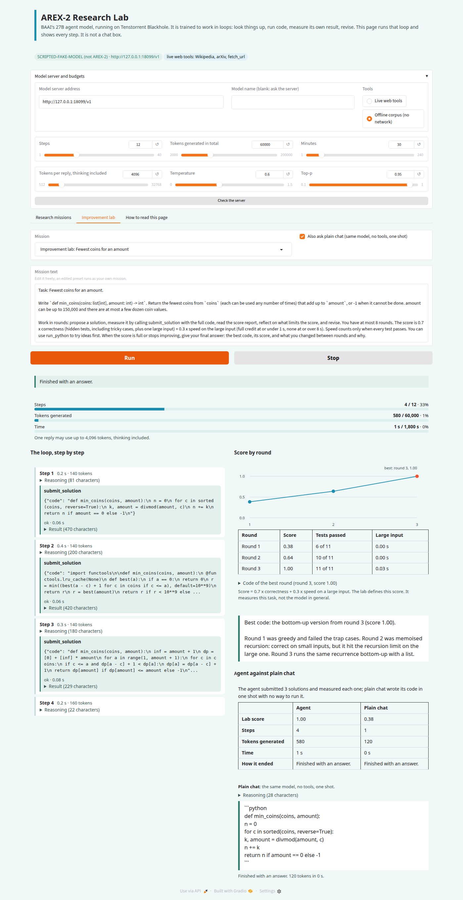

# tt-arex2-agent: a research lab page for AREX-2

A Gradio page for [BAAI/AREX-2](https://huggingface.co/BAAI/AREX-2), a 27B agent model served on Tenstorrent Blackhole. The model is trained to
work in loops: propose, measure, reflect, revise, with tools. A chat box shows one reply. This page runs the loop and shows every step of it.

> The screenshots below were made with a **scripted stand-in model** (the page's badge says `SCRIPTED-FAKE-MODEL (not AREX-2)`). They show
> the page. They are not output of the real model. The improvement-lab scores in them are real: the lab ran the submitted code in its sandbox.


## What it shows

**Research missions.** The agent searches Wikipedia and arXiv, reads pages, calculates, runs Python, and answers with sources.
- *The loop*: every step with its reasoning, the tool it called, the arguments, the result, the tokens and the seconds. Budgets for steps, tokens and time have meters and a stop button.
- *The evidence board*: every source the agent opened, with the text it read. Each claim in the final answer is marked **backed** (words and numbers appear together in retrieved text), **computed** (the numbers come from a calculation) or **not backed**. An address the answer cites but the agent never opened is flagged. This is a string match. It does not judge whether a source is right.
- *Agent against plain chat*: the same question goes to the same model once, with no tools, at the same settings. The scorecard counts sources, claims backed, steps, tokens and time. For the preset missions it also counts how many of the facts checked on Wikipedia or arXiv at build time each answer mentions. That row is a string match. It is not a grade.

**Improvement lab.** The part a chat box cannot show. The agent gets a coding task with hidden tests and a large input. It submits code with `submit_solution`. The lab runs it in a sandbox and returns a measured report: failed tests with their inputs, the runtime on the large input, any error. The agent revises. The chart shows the score per round, and plain chat's one-shot code is scored by the same harness. Score = 0.7 x correctness + 0.3 x speed (speed counts only when every test passes). The lab defines this score. It measures that task only.



**Offline corpus.** A switch serves the tools from a small bundled set of Wikipedia and arXiv pages, with no network. The page badges it. It answers the preset missions and nothing else.

**What it costs.** On the box this was written on, AREX-2 decodes at roughly 14 tokens a second per request with four requests running (drafter off, sampling on the host). A thinking step can take minutes. A reply can be cut off at the per-step limit, and the model sometimes stops inside its reasoning. The page says "the thinking budget ran out" and offers to continue with a larger limit, and it says when the model gave neither an answer nor a tool call.

## Running it

You need a server that speaks the OpenAI chat API for AREX-2 with tool calling and the reasoning parser on: vLLM with `--enable-auto-tool-choice --tool-call-parser qwen3_coder --reasoning_parser qwen3`. The `arex-2-p300` package built by tt-orchard uses those flags.

```bash
python3 -m venv .venv && .venv/bin/pip install -r requirements.txt
```

- **With tt-discolike.** The repo has a `.disco/app.yaml` (`chips: 2`). Start `arex2-research-lab` from the catalog. It runs `serve/serve_arex2.py --ui` under `gozer run --chips 2`, boots the package's `run.sh`, waits for the server, then serves the page on port 7872.
- **By hand, on leased chips.**
  `gozer run --chips 2 --who "you:arex2" --reason "AREX-2 research lab" -- .venv/bin/python serve/serve_arex2.py --ui`
  The launcher refuses to boot the model without a lease (`TT_VISIBLE_DEVICES`), and it always stops the server it started. The package comes from `--run-sh`, `AREX2_RUN_SH` or `~/.cache/tt-model/models/episod/arex-2-p300/run.sh`. If a server already answers on the port it is used as it is.
- **Page only, server already running.** `AREX2_URL=http://host:8000/v1 .venv/bin/python demo/app.py`
- **No chip at all.** `.venv/bin/python tools/demo_stack.py`, open the page, choose *Offline corpus*. This uses the scripted stand-in model.

The page has no login. It binds to 127.0.0.1 unless you set `AREX2_UI_HOST=0.0.0.0`. A visitor can use the model and its tools. Web fetches go through a guard (see below) and code runs in a sandbox, but share it only on a network you trust.

## Tools

`wikipedia_search`, `wikipedia_page`, `arxiv_search` (public APIs, no keys), `fetch_url`, `calculator`, `run_python`, and `web_search` only when `SERPER_API_KEY` or `JINA_API_KEY` is set in the environment (the key is sent in a header and removed from any error text).
- `fetch_url` opens only http and https on ports 80, 443, 8080 and 8443. It resolves the name itself, refuses any private, loopback, link-local or reserved address (including after each redirect), connects to the address it checked, sends no cookies, and caps size and time.
- `run_python` and the lab run code in a Landlock and seccomp sandbox (no network, files only in a scratch directory, a time limit). It is copied from tt-orchard. On a kernel that cannot enforce it, the tools say so and do not run the code.
- Tool results and web pages are untrusted text. The model is told to treat them as data, and the page shows them as escaped text.

## Missions

The preset research missions were built by `tools/build_missions.py`, which reads each fact from Wikipedia or arXiv, requires a pattern to match, keeps the quote and the date, and computes the expected answer from what it read. `python tools/build_missions.py --check` verifies that they still hold. Wikipedia figures can change. The Everest and K2 mission states the date its heights were read.

## Tests

`.venv/bin/python -m pytest -q`. No test needs a chip or the network (the scripted server in `tests/fake_openai.py` streams tool calls and `reasoning_content`; the page is driven through `gradio_client`). Tests that run code skip on a kernel without Landlock. Every guard has a test that was watched failing under a mutation of the code (counts in `CLAUDE.md`).

## What was not run

Nothing here has run against the real model. The streaming client, the loop, the tools, the lab and the page were built and tested against a scripted server. Whether AREX-2 writes tool calls the `qwen3_coder` parser accepts, how often it stops inside its reasoning, how many steps a research mission takes, and how it scores in the lab are all unmeasured. `CLAUDE.md` lists the commands for a first real run. The claim check and the lab thresholds were chosen from the scripted runs and need a look at real output.

## Layout

`arex2_agent/` the library (`chat`, `agent`, `tools`, `netguard`, `code_sandbox`, `evidence`, `lab`, `session`, `missions`, `views`), `demo/app.py` the page, `serve/serve_arex2.py` the launcher, `tools/` the preset builder, the scripted model and the screenshot script, `tests/`. Licence: Apache-2.0. The bundled corpus is trimmed Wikipedia text under CC BY-SA 4.0 with each entry's address kept.
