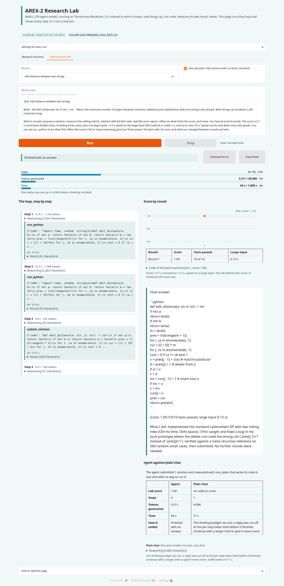
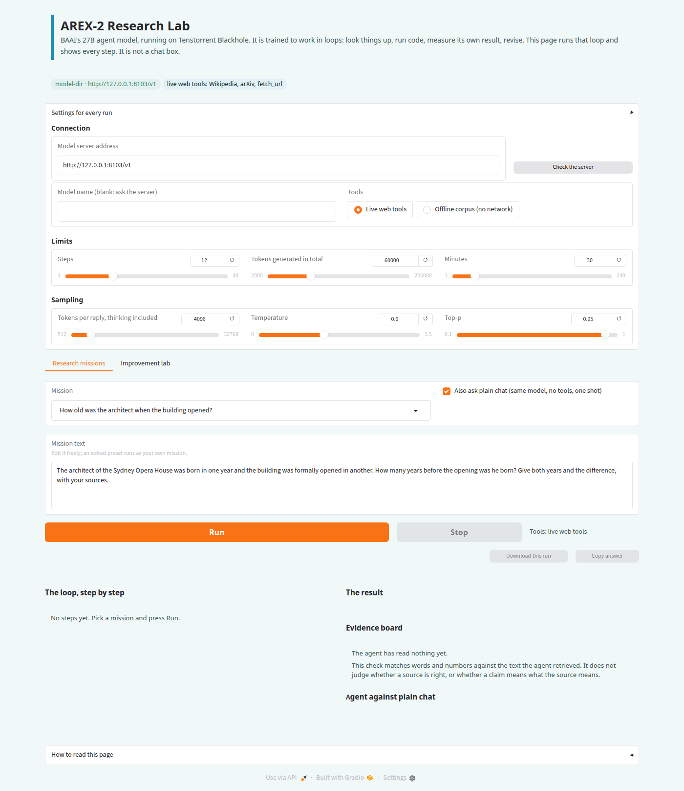
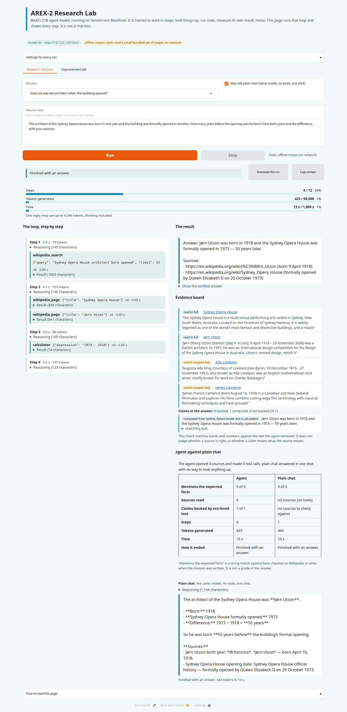
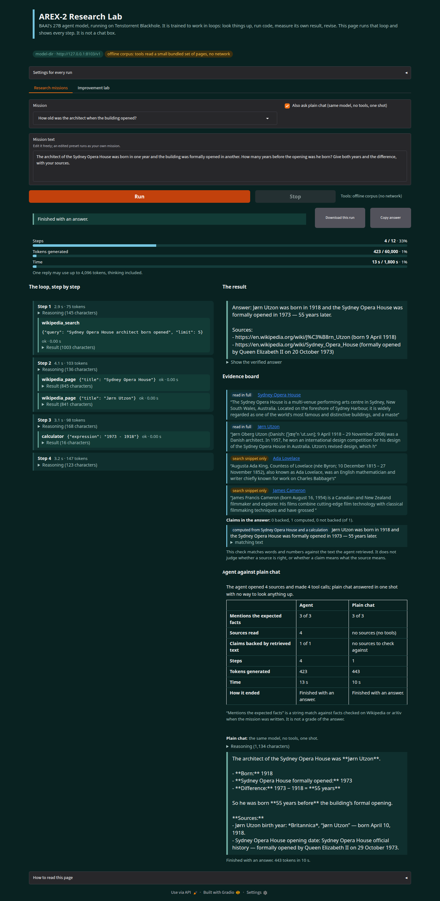
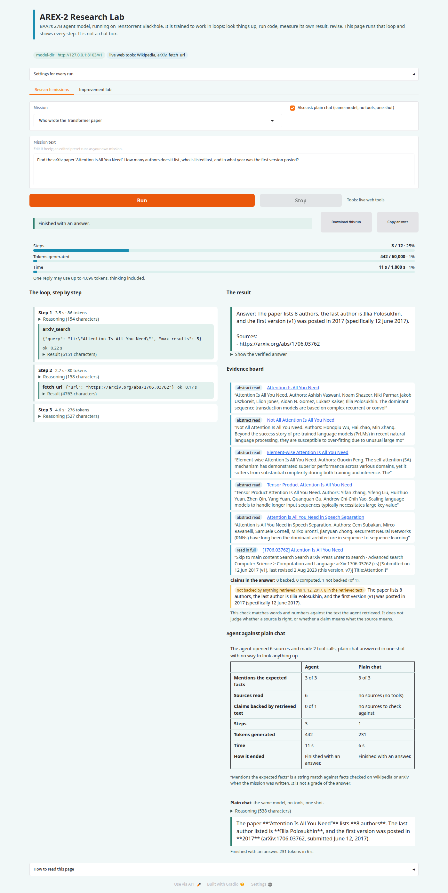

# tt-arex2-agent: a research lab page for AREX-2

A Gradio page for [BAAI/AREX-2](https://huggingface.co/BAAI/AREX-2), a 27B agent model served on Tenstorrent Blackhole. The model is trained to
work in loops: propose, measure, reflect, revise, with tools. A chat box shows one reply. This page runs the loop and shows every step of it.

Model: [`episod/arex-2-p300`](https://huggingface.co/episod/arex-2-p300) on 2 Blackhole chips. Repository: https://github.com/tsingletaryTT/tt-arex2-agent



## What it shows

**Research missions.** The agent searches Wikipedia and arXiv, reads pages, calculates, runs Python, and answers with sources.
- *The loop*: every step with its reasoning, the tool it called, the arguments, the result, the tokens and the seconds. Budgets for steps, tokens and time have meters. Stop is on only while a run is going.
- *The evidence board*: every source the agent opened, with the text it read. Each claim in the final answer is marked **backed** (words and numbers appear together in retrieved text), **computed** (the numbers come from a calculation) or **not backed**. An address the answer cites but the agent never opened is flagged. This is a string match. It does not judge whether a source is right.
- *Agent against plain chat*: the same question goes to the same model once, with no tools, at the same settings. The scorecard counts sources, claims backed, steps, tokens and time. For the preset missions it also counts how many of the facts checked on Wikipedia or arXiv at build time each answer mentions. That row is a string match. It is not a grade.

**Improvement lab.** The part a chat box cannot show. The agent gets a coding task with hidden tests and a large input. It submits code with `submit_solution`. The lab runs it in a sandbox and returns a measured report: failed tests with their inputs, the runtime on the large input, any error. The agent revises. The chart shows the score per round, and plain chat's one-shot code is scored by the same harness. Score = 0.7 x correctness + 0.3 x speed (speed counts only when every test passes). The lab defines this score. It measures that task only.

**Offline corpus.** A switch serves the tools from a small bundled set of Wikipedia and arXiv pages, with no network. The page badges it. It answers the preset missions and nothing else.

**What it costs.** A thinking step can take minutes on a hard task, and a reply can be cut off at the per-step limit (the page default is 4,096 tokens, thinking included). The page says "the thinking budget ran out" and offers to continue with a larger limit. It also says when the model gave neither an answer nor a tool call. Speed depends on the package configuration: the [model card](https://huggingface.co/episod/arex-2-p300) lists the measured single-request decode speed with the drafter on and with it off. Several requests at once were not measured on the current package.

## Using the page

**Settings for every run** is one accordion, closed by default, and it applies to both tabs. It has three groups:
- *Connection*: the model server address with **Check the server** beside it, the model name (blank asks the server), and the tools, either live web tools or the offline corpus.
- *Limits*: steps, tokens generated in total, and minutes.
- *Sampling*: tokens per reply (thinking included), temperature and top-p.

Each tab holds what belongs to one run: the mission, the plain-chat box, and **Run** and **Stop**. Run is off while a run is going, and Stop is on only then. A line beside the buttons says which tools the next run will use ("Tools: live web tools" or "Tools: offline corpus (no network)"). It follows the radio in the settings.

When a run ends, **Download this run** and **Copy answer** turn on beside the status line. Download writes one JSON file with the mission, the settings, every step (reasoning, tool call, arguments, result, tokens, seconds), the answer, the evidence rows, the claim check, the lab rounds and the scorecard. The file has no credentials, no home directories and no login from the server address, and a model name that is a path is cut to its last part. Copy puts the answer text on the clipboard, also on a page opened over plain http, where the browser's clipboard interface is not available. The last twenty downloads are kept in the system temporary folder and older ones are removed.

**How to read this page** is a closed accordion at the bottom.

## What ran on the real model

On 2026-10-23 the page ran against the published package `episod/arex-2-p300` (2 chips, speculative drafter on, sampling on the device), installed with `tt-model pull episod/arex-2-p300`. The images come from `tools/screenshots_real.py` and show the current layout. The model's replies differ a little from run to run, so a run of your own will not match them exactly. The model's tool calls parsed correctly through vLLM's `qwen3_coder` parser, and its reasoning came back in `reasoning_content`. These are one run of each kind. They show what the page does with the real model and are not a benchmark.

**The settings.** One accordion, `Settings for every run`, in three groups: Connection (the server address with its Check button, the model name and the tools), Limits (steps, total tokens, minutes) and Sampling (tokens per reply, temperature, top-p). It is closed by default. The tools mode is also written next to Run in each tab.



**Research mission with the offline corpus: the Sydney Opera House architect.** The agent ran 4 steps (`wikipedia_search`, two `wikipedia_page` reads, `calculator`) in 13 seconds. It answered that Jørn Utzon was born in 1918 and the building opened in 1973, 55 years later, and listed its sources. Plain chat gave the same years. It gave its own birth and opening dates, which differ from the dates in the sources the page shows.





The header badge in these two shows the offline corpus, as selected.

**Research mission with live tools: the Transformer paper.** The agent called `arxiv_search`, then `fetch_url` on the arXiv abstract page, in 3 steps and 11 seconds. It answered that the paper lists 8 authors, that the last author is Illia Polosukhin, and that version 1 was posted on 12 June 2017. The page's claim check marked that answer "not backed". It matches words and numbers literally and listed 1, 12, 2017 and 8 as not found in the retrieved text. Counting names is outside what it does, and the authors and the submission date are in the text the agent retrieved. This is a limit of the check.



**Improvement lab: edit distance.** The model ran its own tests three times with `run_python`, then submitted once. The lab scored the submission 1.00 (10 of 10 tests, 0.11 seconds on the large input) after 5 steps and 82 seconds. The model's final text says nothing changed between rounds: the first submission scored full marks. The lab recorded a single submitted round, so the score chart has one point. Runs of the same task earlier the same day had final texts that described a bug the model caught in its own tests before it submitted, so the wording of that text varies from run to run. Plain chat on the same task ran out of the page's 4,096-token reply limit while thinking and produced no code. That limit is a page setting and says nothing about the model.

Two problems found on that first run are fixed in this repository: the header badge did not follow the tools setting, and a failed server start showed only the end of the server log. The launcher now quotes the first real error with its line number.

## Running it

You need a server that speaks the OpenAI chat API for AREX-2 with tool calling and the reasoning parser on: vLLM with `--enable-auto-tool-choice --tool-call-parser qwen3_coder --reasoning_parser qwen3`. The `arex-2-p300` package built by tt-orchard uses those flags.

```bash
python3 -m venv .venv && .venv/bin/pip install -r requirements.txt
```

- **With tt-discolike.** The repo has a `.disco/app.yaml` (`chips: 2`). Start `arex2-research-lab` from the catalog. It runs `serve/serve_arex2.py --ui` under `gozer run --chips 2`, boots the package's `run.sh`, waits for the server, then serves the page on port 7872.
- **By hand, on leased chips.**
  `gozer run --chips 2 --who "you:arex2" --reason "AREX-2 research lab" -- .venv/bin/python serve/serve_arex2.py --ui`
  The launcher refuses to boot the model without a lease (`TT_VISIBLE_DEVICES`), and it always stops the server it started. The package comes from `--run-sh`, `AREX2_RUN_SH` or `~/.cache/tt-model/models/episod/arex-2-p300/run.sh`. If a server already answers on the port it is used as it is.
- **Page only, server already running.** `AREX2_URL=http://host:8000/v1 .venv/bin/python demo/app.py`
- **No chip at all.** `.venv/bin/python tools/demo_stack.py`, open the page, choose *Offline corpus*. This serves a **scripted stand-in model**, and the page badge says `SCRIPTED-FAKE-MODEL (not AREX-2)`. It shows the page and runs the lab's sandbox. Nothing it writes is output of AREX-2.

The page has no login. It binds to 127.0.0.1 unless you set `AREX2_UI_HOST=0.0.0.0`. A visitor can use the model and its tools. Web fetches go through a guard (see below) and code runs in a sandbox, but share it only on a network you trust.

## Tools

`wikipedia_search`, `wikipedia_page`, `arxiv_search` (public APIs, no keys), `fetch_url`, `calculator`, `run_python`, and `web_search` only when `SERPER_API_KEY` or `JINA_API_KEY` is set in the environment (the key is sent in a header and removed from any error text).
- `fetch_url` opens only http and https on ports 80, 443, 8080 and 8443. It resolves the name itself, refuses any private, loopback, link-local or reserved address (including after each redirect), connects to the address it checked, sends no cookies, and caps size and time.
- `run_python` and the lab run code in a Landlock and seccomp sandbox (no network, files only in a scratch directory, a time limit). It is copied from tt-orchard. On a kernel that cannot enforce it, the tools say so and do not run the code.
- Tool results and web pages are untrusted text. The model is told to treat them as data, and the page shows them as escaped text.

## Missions

The preset research missions were built by `tools/build_missions.py`, which reads each fact from Wikipedia or arXiv, requires a pattern to match, keeps the quote and the date, and computes the expected answer from what it read. `python tools/build_missions.py --check` verifies that they still hold. Wikipedia figures can change. The Everest and K2 mission states the date its heights were read.

## Tests

`.venv/bin/python -m pytest -q`. No test needs a chip or the network (the scripted server in `tests/fake_openai.py` streams tool calls and `reasoning_content`; the page is driven through `gradio_client`). Tests that run code skip on a kernel without Landlock. Every guard has a test that was watched failing under a mutation of the code (counts in `CLAUDE.md`).

## What was not tested

- The other four research missions and two of the four lab tasks (`count_pairs` and `shortest_path`). `min_coins` ran once with the real model and scored full marks on its first submission. That run is not shown here.
- Missions that run close to the step, token or time limits. The runs above used 3 to 5 of 12 steps.
- More than one request at a time.
- How accurate the claim check is on real answers beyond the three above, and whether the lab thresholds suit a task the model finds hard. Both lab tasks run so far scored full marks on their first submission, so the revise loop has not been seen end to end with a score that improves.
- Starting the model from a package pulled from the Hugging Face Hub. The runs used an install built by the packaging check.

## Layout

`arex2_agent/` the library (`chat`, `agent`, `tools`, `netguard`, `code_sandbox`, `evidence`, `lab`, `session`, `missions`, `views`, `export`), `demo/app.py` the page, `serve/serve_arex2.py` the launcher, `tools/` the preset builder, the scripted model and the layout check script (it writes to `docs/stand-in-check/`, which git ignores), `tests/`. Licence: Apache-2.0. The bundled corpus is trimmed Wikipedia text under CC BY-SA 4.0 with each entry's address kept.
